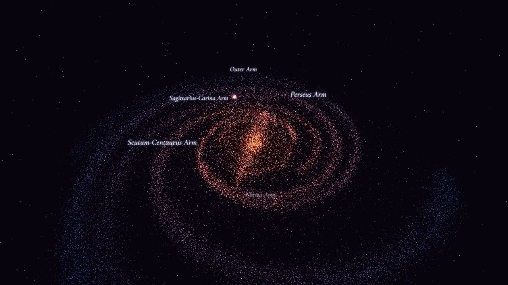

# You Are Here

*A 3D journey from the Milky Way to Earth.*



An interactive 3D Milky Way you can fly through, down to our solar system, with every planet where it really is on any date from 1900 to 2100. Everything is drawn as glowing particles in the browser with [three.js](https://threejs.org); the astronomy comes from [Astronomy Engine](https://github.com/cosinekitty/astronomy).

By Joseph Florendo.

## What's in it

- **The Milky Way, as measured.** A central bar and spiral arms built from the published fits to about 200 parallax distances of young star-forming regions (Reid et al. 2019), with the Sun 8.15 kpc from the centre on the inner edge of the Orion Arm. Nobody has seen our galaxy from outside, so this is a model, and the app says so.
- **One clock.** Live time, or run it forwards and backwards at up to a year a second, between 1900 and 2100. The date is always on screen.
- **The solar system on that date.** The Sun, the planets and the dwarf planet Pluto where Astronomy Engine puts them (to within about 1 arcminute), tilted and spinning by the IAU rotation models, so Venus, Uranus and Pluto spin backwards. Orbit lines and names can be switched on and off.
- **Earth** with real land colours, city lights on the night side, raised mountains, an atmosphere, the Moon with its real phase, and real solar eclipses seen from where they are greatest.
- **Honest scale, and true scale.** A note under the clock always says what is and isn't to scale. A switch shows the solar system with true sizes, true distances or both, with every name and marker still findable. The About panel lists what is computed and what is illustrative.
- **Info cards** for the Sun, the planets, Pluto, the Moon and the galaxy's features: cited facts (with known moons "as of" a date), plus live values for the clock's date: distance from Earth and from the Sun, how long light takes, and which constellation it is in.
- **A size line-up and a light-time ladder**: the planets side by side at their true relative sizes, and how long light takes to reach us from each, out to the Orion Nebula and the galactic centre.
- **A tour** from the galaxy to every planet and back, with captions; it can be saved as a video file (Chrome or Edge on a computer).

## Running it

Open `index.html` in a browser (a double-click works; it then loads three.js and the fonts from the web). Served from a web server, it uses its own copies in `vendor/`.

Keyboard: **G** Go to, **J** travel between the galaxy and Earth, **[** and **]** run time slower or faster, **K** pause time, **Y** back to now, **L** the next solar eclipse, **X** the scale, **C** the tour, **I** about, **M** reduce motion, **H** hide the controls. The **?** button lists everything.

## Tests

```
cd tools
npm install
node science.js
CHROME_PATH=<path to Chrome> node science-browser.js
CHROME_PATH=<path to Chrome> node smoke.js
```

`science.js` checks the galaxy model and the astronomy (positions, the Moon's phase, tilts, eclipses, the clock and the scale system) against published figures and Astronomy Engine; `science-browser.js` checks what is actually in the scene; `smoke.js` plays the tour on a desktop-sized and a phone-sized screen and fails on any error; `stage6-check.js` checks the info cards, the scale modes (true scale really is to scale) and the compare panels; `served.js` checks that the site runs from a web server with no outside requests.

## Sources and credits

Every science figure is cited in [SOURCES.md](SOURCES.md). Libraries, fonts, maps and data keep their own licences: see [THIRD-PARTY-NOTICES](THIRD-PARTY-NOTICES). NASA images are used under NASA's media guidelines; NASA does not endorse this project.

## Licence

The code is [MIT](LICENSE).
